# Цель работы

Приобретение практических навыков работы в Midnight Commander. Освоение инструкций языка ассемблера mov и int.

# Выполнение лабораторной работы

Я открыл Midnight Commander командой `mc` и перешёл в каталог `~/work/arch-pc`.

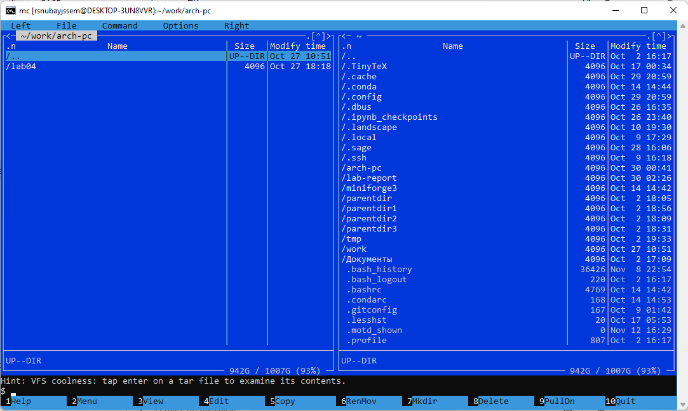

С помощью клавиши F7 я создал каталог lab05 и перешёл в него.

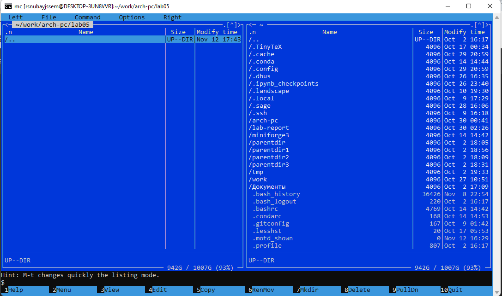

Командой `touch` я создал файл lab5-1.asm.

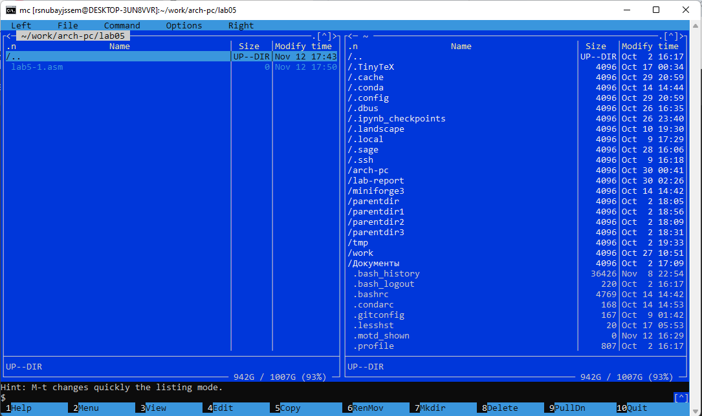

Клавишей F4 я открыл файл во встроенном редакторе nano.

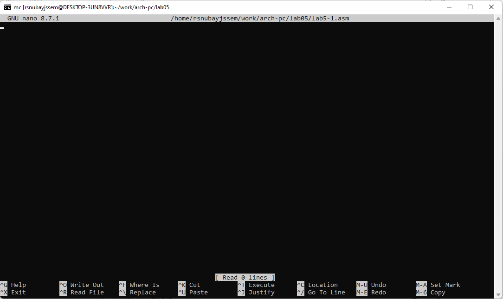

Я ввёл текст программы из листинга 5.1 и сохранил файл.

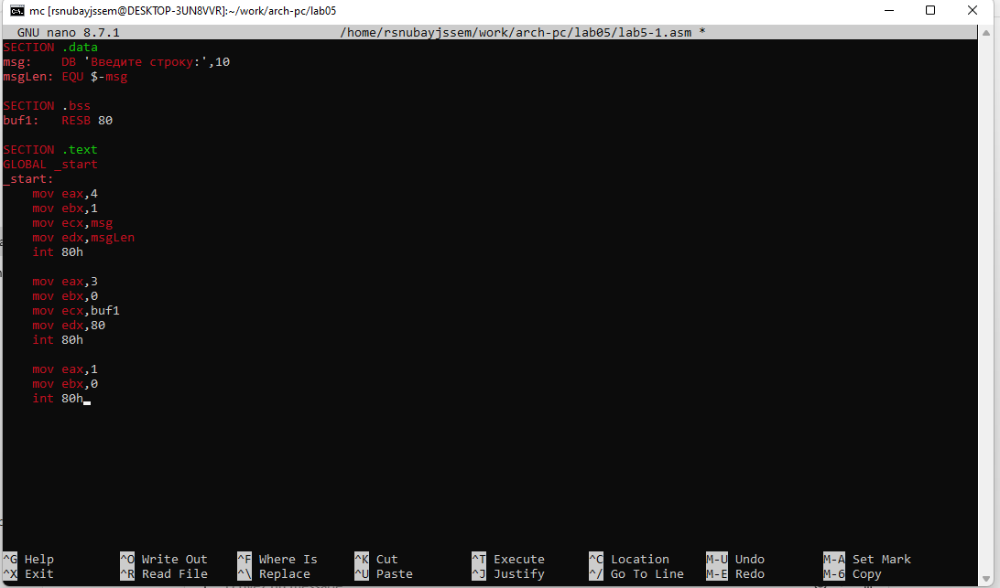

Клавишей F3 я открыл файл для просмотра и убедился, что он содержит текст программы.

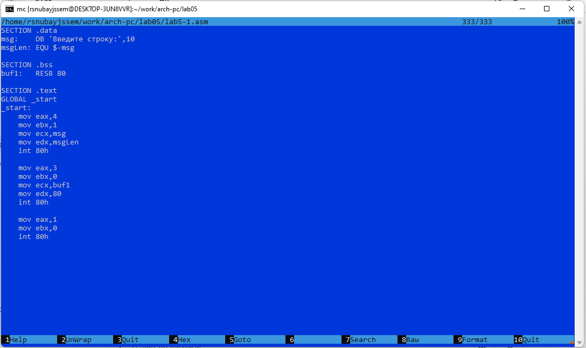

Я оттранслировал программу в объектный файл, выполнил компоновку и запустил исполняемый файл. Программа вывела «Введите строку:» и ожидала ввода; я ввёл свои ФИО.

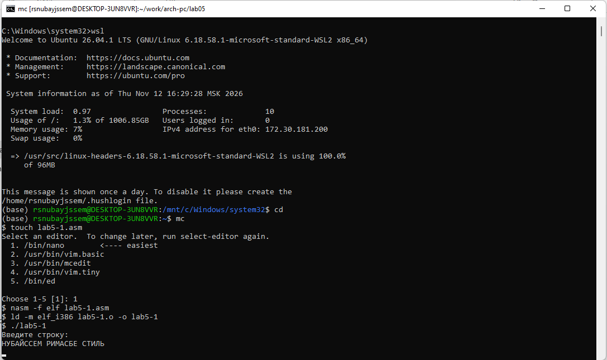

Я скачал файл in_out.asm со страницы курса в ТУИС.


Клавишей F5 я скопировал in_out.asm в каталог с lab5-1.asm, так как подключаемый файл должен лежать в одном каталоге с программой.

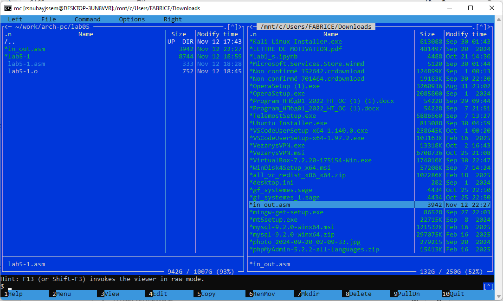

Я создал копию lab5-1.asm с именем lab5-2.asm (клавишей F5, чтобы сохранить исходный файл).

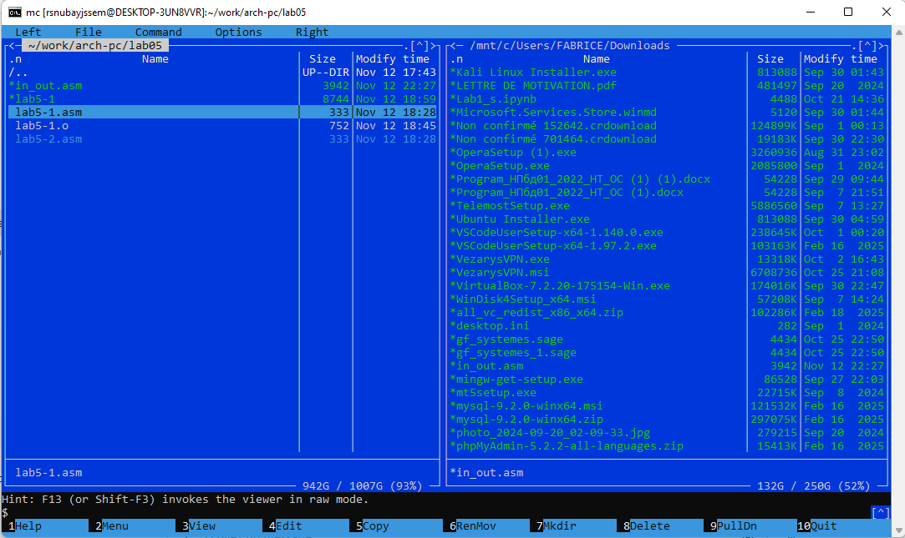

Я исправил lab5-2.asm с использованием подпрограмм sprintLF, sread и quit из in_out.asm, создал исполняемый файл и проверил его работу.

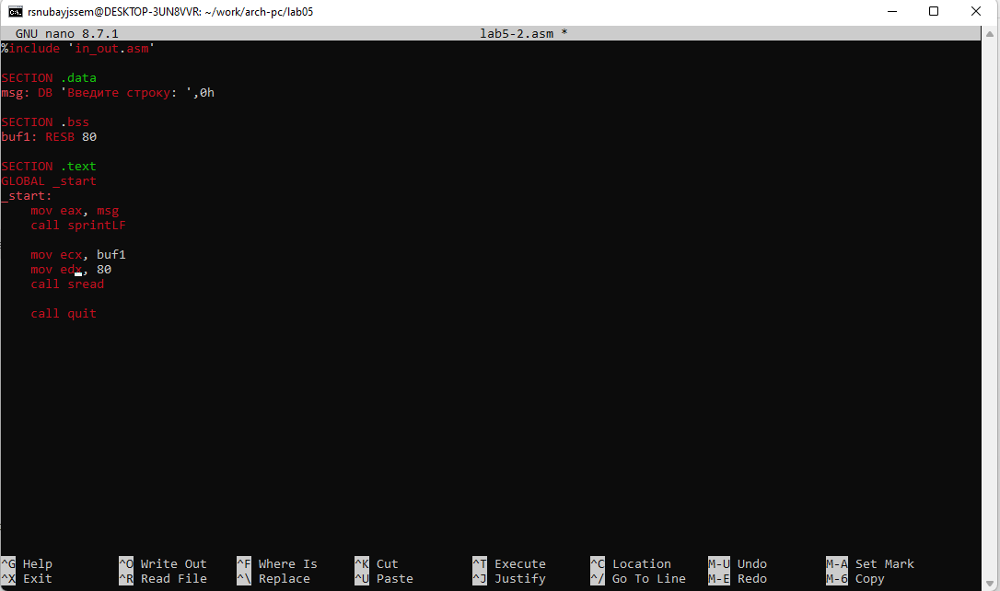

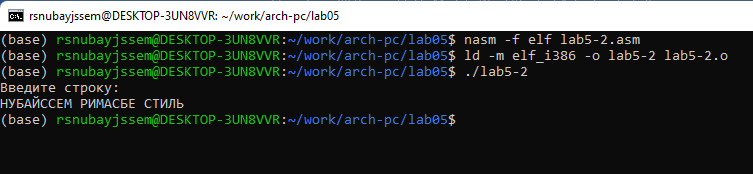

Затем я заменил sprintLF на sprint.

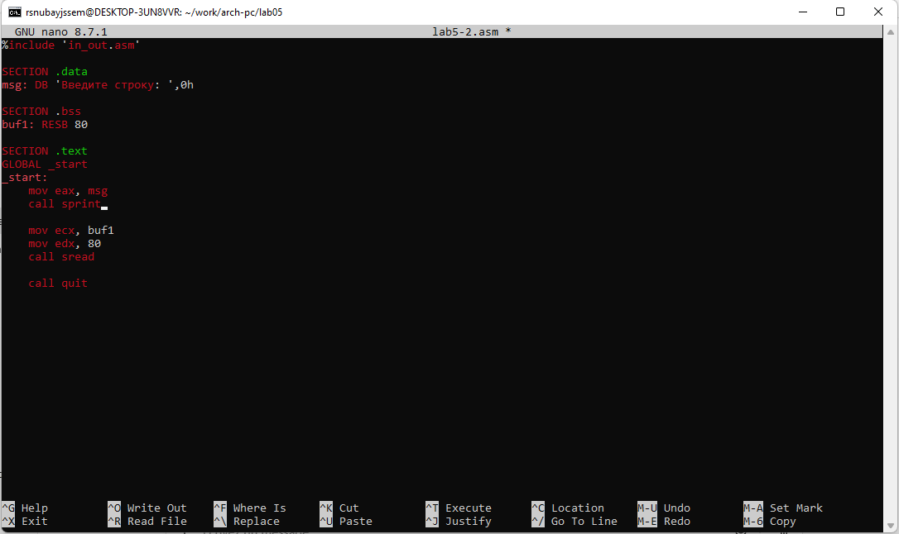

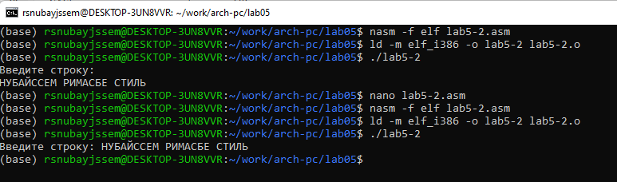

**В чём разница?** Подпрограмма sprintLF выводит сообщение и добавляет в конец символ перевода строки, поэтому ввод осуществляется с новой строки. Подпрограмма sprint не добавляет символ перевода строки, поэтому ввод осуществляется на той же строке, сразу после сообщения.

# Выполнение заданий для самостоятельной работы

## Задание 1–2. Программа без in_out.asm

Я создал копию lab5-1.asm с именем lab5-1-1.asm и изменил программу: она выводит приглашение, вводит строку с клавиатуры и выводит введённую строку. Для вывода добавлен ещё один системный вызов write; длина берётся из регистра eax, где после read хранится число прочитанных байт. Кириллица при вводе с клавиатуры искажается консолью Windows, поэтому фамилия введена латиницей.

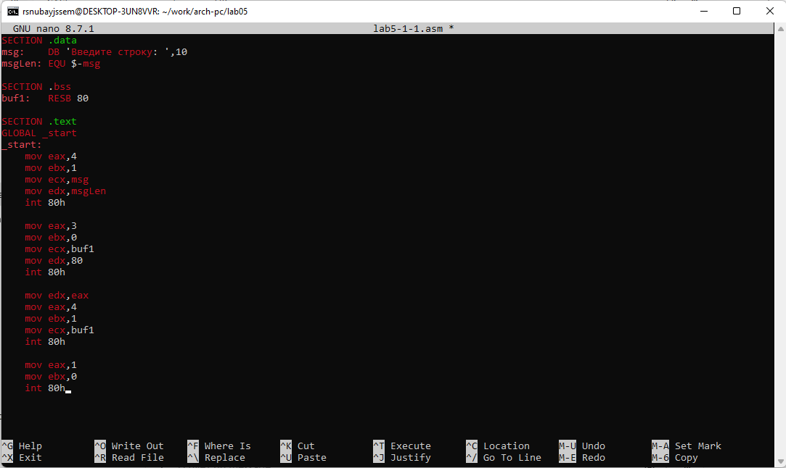

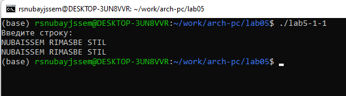

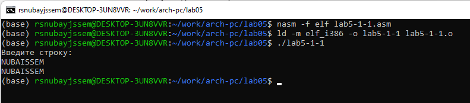

Листинг lab5-1-1.asm:

```nasm
SECTION .data
msg:    DB 'Введите строку: ',10
msgLen: EQU $-msg

SECTION .bss
buf1:   RESB 80

SECTION .text
GLOBAL _start
_start:
    mov eax,4
    mov ebx,1
    mov ecx,msg
    mov edx,msgLen
    int 80h

    mov eax,3
    mov ebx,0
    mov ecx,buf1
    mov edx,80
    int 80h

    mov edx,eax
    mov eax,4
    mov ebx,1
    mov ecx,buf1
    int 80h

    mov eax,1
    mov ebx,0
    int 80h
```

## Задание 3–4. Программа с in_out.asm

Я создал копию lab5-2.asm с именем lab5-2-1.asm и исправил её с использованием подпрограмм sprint, sread и quit. Файл in_out.asm находится в том же каталоге.

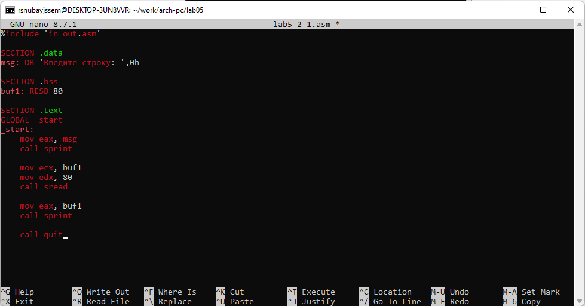

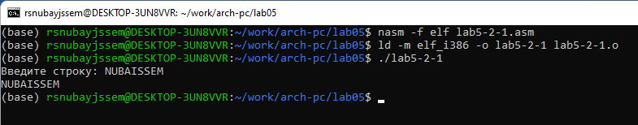

Листинг lab5-2-1.asm:

```nasm
%include 'in_out.asm'

SECTION .data
msg: DB 'Введите строку: ',0h

SECTION .bss
buf1: RESB 80

SECTION .text
GLOBAL _start
_start:
    mov eax, msg
    call sprint

    mov ecx, buf1
    mov edx, 80
    call sread

    mov eax, buf1
    call sprint

    call quit
```

# Ответы на вопросы для самопроверки

1. **Каково назначение mc?** Midnight Commander (mc) — файловый менеджер с текстовым интерфейсом. Он позволяет просматривать структуру каталогов и выполнять основные операции по управлению файловой системой, делая работу с файлами более удобной и наглядной.

2. **Какие операции с файлами можно выполнить и в bash, и в mc?** Копирование (`cp` и F5), перемещение или переименование (`mv` и F6), создание каталога (`mkdir` и F7), удаление (`rm` и F8), просмотр файла (`cat`, `less` и F3), редактирование (`nano` и F4).

3. **Какова структура программы на языке ассемблера NASM?** Программа состоит из трёх секций: `SECTION .data` (инициализированные данные), `SECTION .bss` (неинициализированные данные) и `SECTION .text` (код программы). В `.text` объявляется точка входа `GLOBAL _start`, а программа заканчивается системным вызовом exit.

4. **Для описания каких данных используются секции bss и data?** В `.data` описываются переменные с заданным начальным значением. В `.bss` при трансляции только резервируется память, а значение присваивается в ходе выполнения программы.

5. **Для чего используются db, dw, dd, dq и dt?** Эти директивы резервируют память и задают значения в секции `.data`: `DB` — 1 байт, `DW` — 2 байта, `DD` — 4 байта, `DQ` — 8 байт, `DT` — 10 байт. Они применяются для простых переменных, массивов и строк.

6. **Какое действие произойдёт при выполнении `mov eax, esi`?** Значение регистра `esi` будет скопировано в регистр `eax`; содержимое `esi` не изменится.

7. **Для чего используется инструкция `int 80h`?** Она вызывает системный вызов ядра Linux. Номер функции помещается в `eax`, параметры — в `ebx`, `ecx`, `edx`, результат возвращается в `eax`. Например, `eax = 4` — write, `eax = 3` — read, `eax = 1` — exit.

# Выводы

В ходе лабораторной работы я приобрёл практические навыки работы с файловым менеджером Midnight Commander и освоил структуру программы на языке ассемблера NASM (секции .data, .bss и .text). Я изучил инструкции mov и int, системные вызовы write, read и exit, научился подключать внешний файл in_out.asm директивой %include и использовать подпрограммы sprint, sprintLF, sread и quit. В самостоятельной работе я реализовал вывод введённой строки двумя способами: с системными вызовами и с подпрограммами из in_out.asm.
